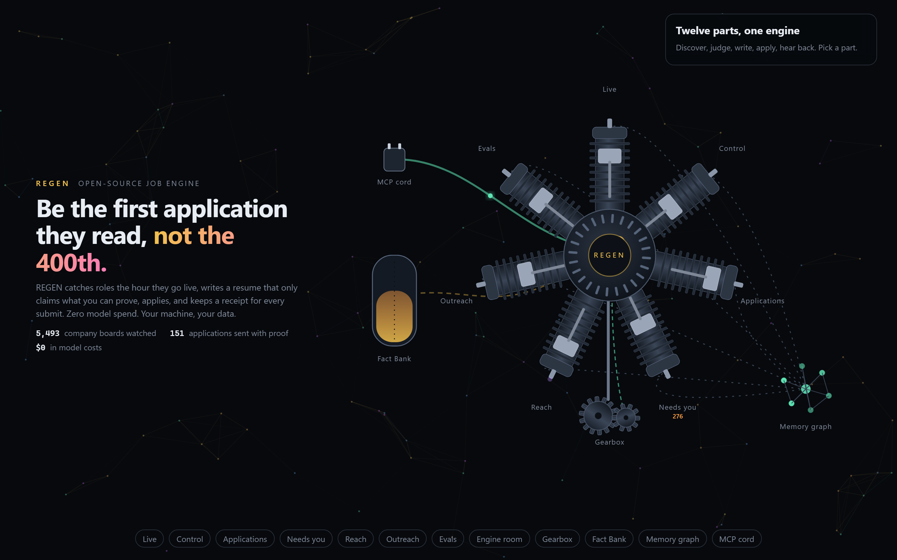
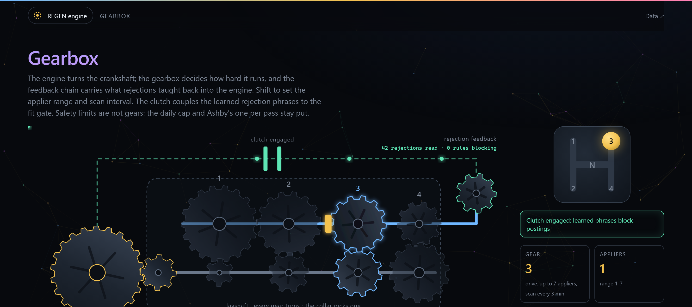
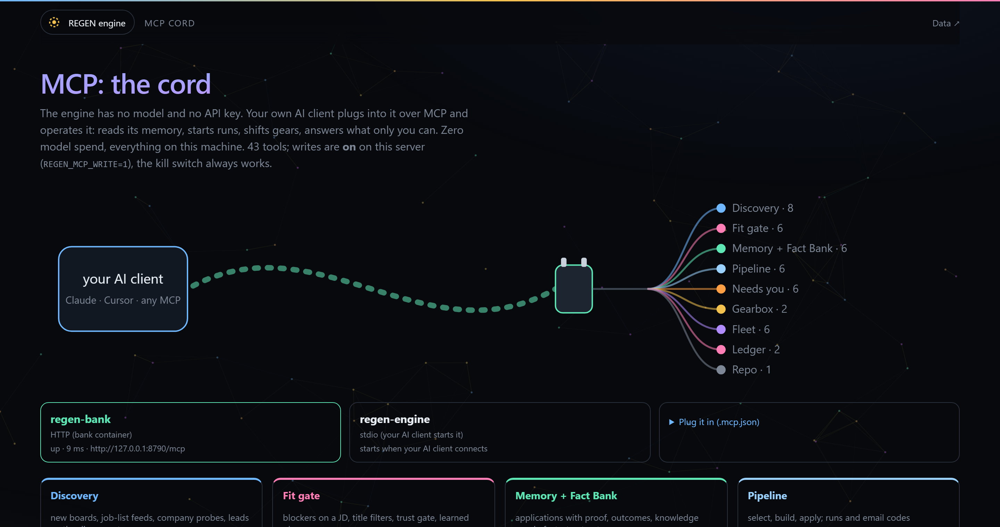

<div align="center">

# REGEN

**Be the first application they read, not the 400th.**

An open-source job engine that finds roles at the source, writes a resume that only claims what you can prove,
applies, and keeps a receipt for every submit. Your AI drives it. Zero model spend.

[](https://github.com/sameernagar-hub/regen-engine/actions/workflows/ci.yml)
[](LICENSE)
[](https://github.com/sameernagar-hub/regen-engine/wiki/Zero-Cost-and-MCP)
[](https://github.com/sameernagar-hub/regen-engine/wiki/MCP-Tools)

**[Live demo](https://regen-engine.onrender.com)** · [How it works](https://github.com/sameernagar-hub/regen-engine/wiki/How-it-works) · [Quick start](#quick-start) · [Wiki](https://github.com/sameernagar-hub/regen-engine/wiki) · [Technical reference](https://github.com/sameernagar-hub/regen-engine/wiki/Technical-Reference)

<a href="https://regen-engine.onrender.com"></a>

</div>

## The problem

A role goes live on a company's careers page. It reaches LinkedIn a day later, behind hundreds of identical resumes.
Auto-apply tools make it worse: one resume for every posting, invented answers for every gap.

## What REGEN does

- **Gets there first.** Polls ~6,400 employer boards on 9 ATSs, six big-tech careers portals and the venture-fund job portals (YC, Getro and Consider fund boards) directly, rescanning every few minutes, so roles are caught the hour they go live. Startups with no public board are traced through their own careers pages. [Discovery →](https://github.com/sameernagar-hub/regen-engine/wiki/Discovery)
- **Never bluffs.** Every resume line comes from your Fact Bank; a validator rejects anything else. Each application also carries a short cover note built from the same facts. [Tailoring →](https://github.com/sameernagar-hub/regen-engine/wiki/Tailoring)
- **Skips what you'd lose.** A fit gate reads the whole job description first: sponsorship, years, clearance, stack. [Fit gate →](https://github.com/sameernagar-hub/regen-engine/wiki/Fit-Gate)
- **Learns from no.** Every rejection is read back and compared with the job descriptions that weren't rejected. [Feedback →](https://github.com/sameernagar-hub/regen-engine/wiki/Rejection-Feedback)
- **Proves it.** A submit counts only when the confirmation page is saved. [Evidence →](https://github.com/sameernagar-hub/regen-engine/wiki/Evidence)
- **Costs nothing to think.** No model keys: Claude, Cursor or any MCP client operates it. [Zero cost →](https://github.com/sameernagar-hub/regen-engine/wiki/Zero-Cost-and-MCP)

## By the numbers

| 387 | 49 | ~6,400 | 43 | 0 |
|:-:|:-:|:-:|:-:|:-:|
| applications submitted | best day | employer boards watched | MCP tools | model API keys |

From the engine's own ledger as of 2026-10-30 (latest status per posting; `python -m engine report` lists the ones whose confirmation screenshot is still on disk). 269 tests in CI, plus a privacy gate on every push. [Metrics →](https://github.com/sameernagar-hub/regen-engine/wiki/Metrics)

## How it works

```
 discover ──► fit gate ──► compose ──► apply ──► inbox
    ▲            ▲                       ▲         │
    │            └──── rejection feedback ◄────────┘
    │                                    │
  sources ◄──────── MCP: your AI client ─┴──► gearbox (speed)
```

| | |
|:-:|:-:|
|  |  |
| **[Gearbox](https://github.com/sameernagar-hub/regen-engine/wiki/Gearbox).** One shift sets appliers and scan rate; the clutch couples what rejections taught. | **[The cord](https://github.com/sameernagar-hub/regen-engine/wiki/MCP-Tools).** 43 MCP tools reach every level, from finding new job sources to the kill switch. |

**[Maintenance](https://github.com/sameernagar-hub/regen-engine/wiki/Maintenance)** (the engine's "oil change"). Every application leaves
leftovers: tailored resumes, job-description copies, verification-code and job-alert mail, closed postings, Docker cache.
The supervisor measures them every 5 minutes as a health score and clears them once a day (or on a click at `/oilchange`),
playing each step live and logging what each one removed. Proof is shrunk, never deleted; your Fact Bank, answers, application log and starred mail are never touched.

Everything runs in Docker on your machine: a pipeline, N appliers (headed Chromium), a supervisor that scales them,
a feedback loop on your inbox, a Postgres ledger, the control room, and the MCP server.
[Architecture →](https://github.com/sameernagar-hub/regen-engine/wiki/Architecture)

## Quick start

```bash
git clone https://github.com/sameernagar-hub/regen-engine && cd regen-engine
cp -r profile.example profile        # your facts and answers, once (git-ignored)
docker compose -f deploy/bank.compose.yml run --rm seed
REGEN_MCP_WRITE=1 docker compose -f deploy/bank.compose.yml up -d
```

Open the control room at http://127.0.0.1:3000 and plug your AI client into `http://127.0.0.1:8790/mcp`.
Step by step: [Running the engine](https://github.com/sameernagar-hub/regen-engine/wiki/Running) · [Configuration](https://github.com/sameernagar-hub/regen-engine/wiki/Configuration) · [Technical reference](https://github.com/sameernagar-hub/regen-engine/wiki/Technical-Reference).

## Guardrails

Legal, sponsorship and EEO answers come only from your presets. CAPTCHAs and human checks always go to you.
Personal data is only typed into employer-owned ATS forms that pass a scam check. Your data stays on your machine;
the only things published are an anonymized activity feed and the code, and a privacy gate blocks names and secrets from both. [Truthfulness and safety →](https://github.com/sameernagar-hub/regen-engine/wiki/Truthfulness-and-Safety)

## Learn more

[Wiki](https://github.com/sameernagar-hub/regen-engine/wiki) · [How it works](https://github.com/sameernagar-hub/regen-engine/wiki/How-it-works) · [Architecture](https://github.com/sameernagar-hub/regen-engine/wiki/Architecture) · [MCP tools](https://github.com/sameernagar-hub/regen-engine/wiki/MCP-Tools) ·
[Roadmap](https://github.com/sameernagar-hub/regen-engine/wiki/Roadmap) · [FAQ](https://github.com/sameernagar-hub/regen-engine/wiki/FAQ) · [Changelog](CHANGELOG.md) · MIT licensed
