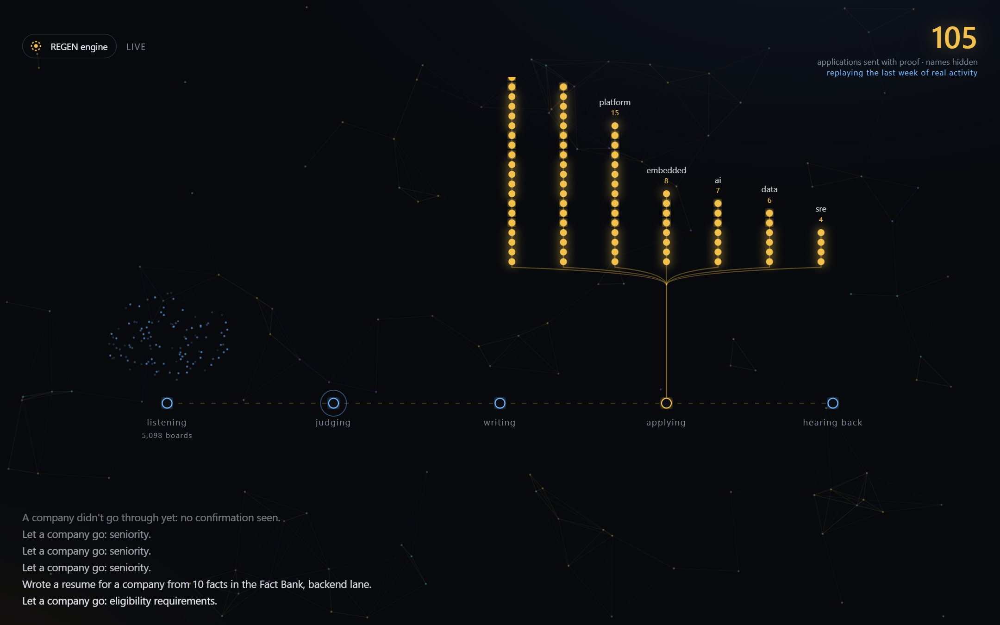
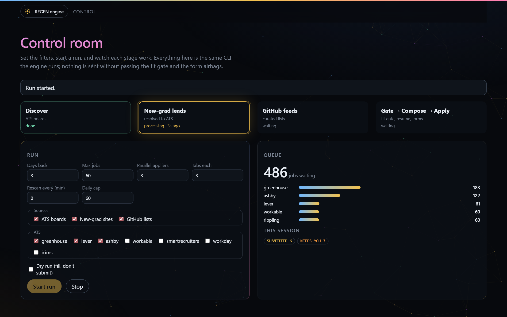
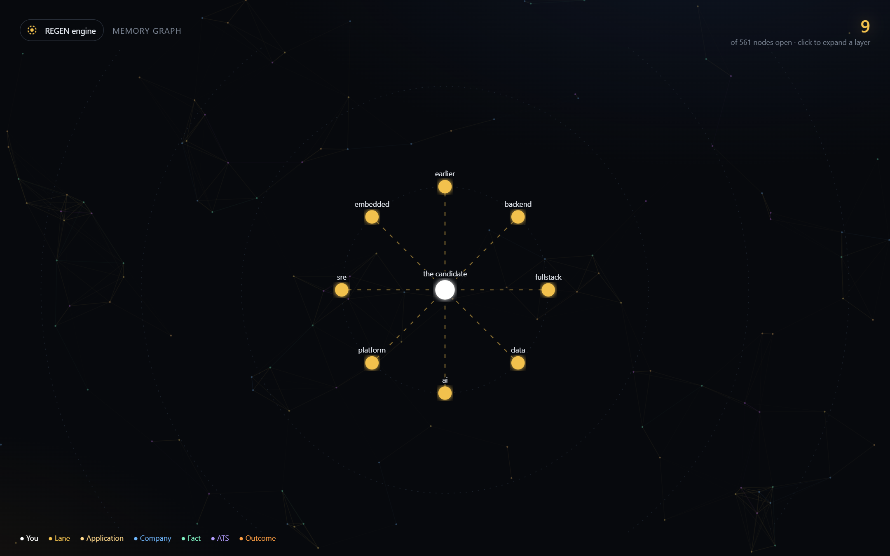
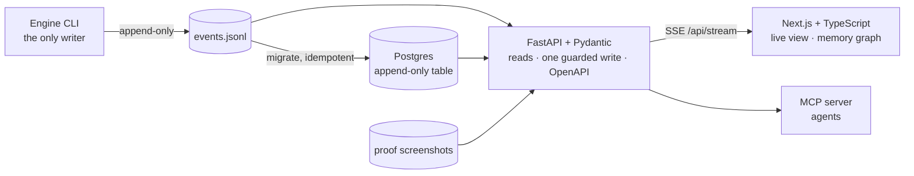
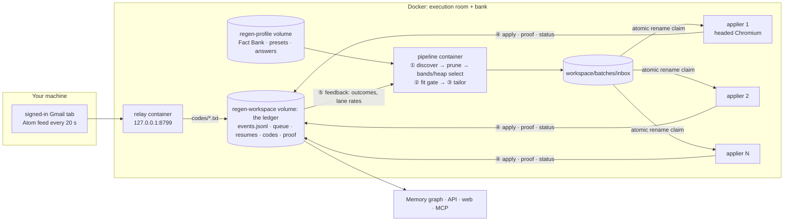

<div align="center">

# REGEN

### The autonomous job engine. Source-first discovery, proof-backed tailoring, receipts for every submit.

**Hit the role in its first hour, not its first week, with a resume that can't lie.**

[](https://github.com/sameernagar-hub/regen-engine/actions/workflows/ci.yml)
[](LICENSE)
[](pyproject.toml)
[](apps/web)
[](apps/api)
[](engine/connectors/mcp_server.py)
[](docs/wiki/Zero-Cost-and-MCP.md)
[](SECURITY.md)



<sub>The live view, company names hidden. Each gold bead is an application with a saved confirmation page, grouped by the resume lane that wrote it; the field behind it pulses with every real engine event.</sub>

**[Live demo](https://regen-engine.onrender.com)** · **[Why REGEN](#why-regen)** · **[What's new](#whats-new-v016-front-door-the-engine-is-the-menu-and-the-public-site-works-end-to-end)** · **[Features](#features)** · **[Quick start](#quick-start)** · **[Architecture](#architecture)** · **[Platform](#the-platform-v07)** · **[Roadmap](#roadmap)**

</div>

---

## Why REGEN

**The problem.** A role goes up on a company's own careers page. It reaches LinkedIn a day or two later, and by then
hundreds of near-identical resumes are already in the queue. Auto-apply tools make this worse: they send the same
resume to every posting and make up answers to fill the gaps.

**The wedge.** REGEN works at the source and refuses to bluff:

- **Source-first discovery.** It polls ~2,370 company boards across four ATS APIs directly, resolves job-alert emails
  and new-grad lists back to the employer's own posting, and queues roles within minutes of going live.
- **A fit gate before any effort.** Citizenship, clearance, no-sponsorship, graduation windows, years required and core
  stack are checked against the JD first. Roles you'd be screened out of never cost a resume or a form.
- **One resume per job, built only from facts you can prove.** A Fact Bank of verifiable lines, a JD-first composer that
  ranks and orders them, a validator that rejects any claim not in the bank, and an ATS read-back that measures what
  a parser actually extracts from the PDF (typically 85–100% of the JD terms you have).
- **Applying at machine speed, with your judgment on the decisions that matter.** Round-robin scheduling across tabs and
  parallel appliers. Legal and status answers come only from your presets. Open questions are drafted from your facts
  and logged. CAPTCHAs, arbitration agreements and self-certifications always come to you.
- **Receipts, not claims.** A submission counts only when the company's confirmation page is saved as proof. Every
  answer, every fact id and every skip reason is in an append-only event log.
- **Zero cost, your AI drives it.** No model API keys. The AI client you already use (Claude, Cursor, any MCP client)
  operates the engine over MCP: start runs, read the inbox, deliver email codes, answer blocking questions.
- **Trust before data.** Personal data is only typed into employer-controlled ATS forms that pass a scam check.

## By the numbers

| | |
|---|---|
| Applications submitted | **165** to date (latest status SUBMITTED in the ledger); **96** still have their confirmation screenshot on disk (older proofs were pruned by the retention policy) · best day **49** (2026-10-10) · `python -m engine report` |
| Company boards polled directly | **5,094** on Greenhouse, Ashby, Lever, Workable, Workday, SmartRecruiters, iCIMS (`workspace/boards.json`) |
| Sources resolved back to the employer | LinkedIn alert mail over IMAP, job-alert emails (7 platforms), newgrad-jobs.com, 25 GitHub job lists, HN "Who is hiring", big-tech careers APIs |
| Outcomes read from your mail | **38** rejections, **1** assessment, 160 confirmations (decoded bodies from All Mail; each rejection reviewed against its JD) |
| Fit gate vs past rejections (B7) | catches **18.2%** of rejections that had a stored JD, at a cost of **2.2%** of the rest (was 9.1% / 1.1% before the 10-13 review) |
| Resume ATS read-back | **77–100%** of matched JD terms extractable from the PDF; coverage fill puts most at **100%** of the JD terms you have (build log: `resume covers 24/24 JD terms, ATS text 100%`) |
| Email security codes | **hands-free** via the code relay: a Gmail tab posts codes from the Atom feed every 20 s (`engine relay`, `workspace/logs/relay_*.log` shows each delivery) |
| Scheduler | ×2.05 throughput vs sequential (seeded benchmark, `scripts/bench_scheduler.py`) |
| Tests | **158** passing; system benchmarks B1–B7 in `engine/bench.py` (`python -m engine bench`, rerun by the supervisor every 6 h) (unit, API, trust gate, priority, headless form tests against local ATS look-alikes) |
| Resume claims outside your Fact Bank | **Rejected** by the validator before any PDF is written |
| Model API keys required | **0** |
| Applier capacity | **N containers** (`--scale applier=N`), each a headed Chromium with its own profile; 5 workers + 1 pipeline container on an 8 GB Docker VM |

All numbers come from this repo's own logs and benchmarks. Run `python -m engine report` to check the verified count.

## What's new (v0.16 "Front door"): the engine is the menu, and the public site works end to end

**[Open the live engine →](https://regen-engine.onrender.com)** Hover any part to light it up, click to go inside.

- **The engine is the navigation.** The front page is an animated radial engine: seven cylinders are the working
  views (Live, Control, Applications, Needs you, Reach, Outreach, Evals), the crankcase is the Engine room, the fuel
  tank is the Fact Bank, and the ignition harness wires every cylinder to the Memory graph. Each part shows its live
  number on hover; a click zooms into the part as its page opens. The top tab bar is gone: inner pages carry a dock
  back to the engine. Keyboard, screen-reader and phone users get the same parts as a list.
- **Every page works on the public site.** Render can't reach an engine running in Docker on your machine, so
  `scripts/proxy_dataset.py` builds a synthetic engine (a fictional candidate, made-up companies on `example.com`
  boards, a week of events of every kind, fleet heartbeats, reach list, evals, outreach), runs the **real API** over
  it and saves every response to `apps/web/public/proxy/`. In public mode `lib/proxy.ts` serves those files with
  timestamps moved to "now", and acts out the writes in your tab: answer a question on Needs you, start or stop a
  run in Control, edit filters, mark a reach job submitted, open resume PDFs and proof pages. Same shapes as your
  machine, zero personal data (the privacy gate scans the dataset like any other file). The Live view still plays
  the real anonymized feed.
- Rebuild the dataset after an API change: `python scripts/proxy_dataset.py`.

## What's new (v0.13 "Reach")

- **Workday, iCIMS and SmartRecruiters discovery.** 2,500+ more employer boards, read from public APIs (Workday's
  cxs search JSON, the SmartRecruiters Posting API) and iCIMS portal pages. Those portals put the form behind a
  candidate account, so the engine does everything up to the click: the same fit gate, trust gate and tailored resume.
- **Reach page (`/reach`).** One job at a time: open the posting, preview or download its tailored resume, copy each
  answer from the fill kit (your presets and Fact Bank, the same values the engine types elsewhere), then mark it
  submitted. Marks go to the ledger, so a role you submitted is never listed or applied to again.
- **The outcome loop reads your real mail.** Decoded bodies from All Mail, not raw MIME from the inbox: about 30
  rejections had been read as confirmations. Every rejection was then checked against its job description, and the fit
  gate learned from it ("N+ years in <field>", pre-sales "sales track" roles, non-engineering titles, one role posted
  per region counts once). The log stays append-only: corrections are newer records, retractions are `void` records.
- **More sources in the loop:** LinkedIn alert mail over IMAP (hourly), new-grad sites and GitHub lists every 30 min.
- **Supervisor view in `/control`:** every container's state, uptime, CPU and memory, and benchmarks B1-B7 rerun
  every 6 hours (`python -m engine bench`).
- **Form fixes:** the Greenhouse Employment block (company, title, dates, current role) and Ashby's region-only
  location search, plus radio groups outside field entries.

## What's new (v0.12): the engine runs in Docker

Docker is now the execution room **and the bank**. Your data lives in two Docker named volumes, not local folders:
`regen-profile` (Fact Bank, presets, answers: the knowledge) and `regen-workspace` (the ledger: `events.jsonl`, queue,
resumes, proof, codes). Every container reads and writes the bank:

- **pipeline** discovers, prunes, selects and tailors, then drops batch parts into the bank's inbox
- **applier × N** claim parts with an atomic rename and fill forms in headed Chromium on a virtual display
- **relay** receives email codes from your signed-in Gmail tab (published on 127.0.0.1 only) and writes them to the bank

A crashed container loses nothing; every status, answer and proof is already in the ledger.

```bash
docker compose -f deploy/bank.compose.yml run --rm seed                                  # once: copy local data into the bank
REGEN_MAX_PER_DAY=150 REGEN_PARTS=5 docker compose -f deploy/bank.compose.yml up -d --scale applier=5
# Gmail tab: paste engine/discovery/gmail_relay.js   ·   back up: see deploy/bank.compose.yml
```

| | Evidence |
|---|---|
| Data bank in Docker volumes | `deploy/bank.compose.yml` (seed, applier, pipeline, relay); seeded 2026-10-10 with the profile + 229 MB ledger |
| Atomic-claim workers, no broker | `engine/apply/worker.py`, `test_worker_claims_each_batch_once` |
| Freshness bands (hour > day > week > cold) with a lazy-heap top-k | `engine/pipeline.py:select`, `test_select_prefers_fresh_band` |
| Onsite roles rank above remote | `engine/discovery/priority.py:score` (`onsite` part) |
| Queue prune: only fillable jobs stay | `engine/pipeline.py:prune` (229 to 17 fillable found on 10-10; the 30-day scan grew the queue to 488 usable) |
| Ashby burst guard: 1 per pass across all workers | `REGEN_ASHBY_PER_PASS`; added after 5 parallel workers tripped Ashby's bot check |
| Disk hygiene every pass | `engine/clean.py` (first run freed 459 MB of logged proofs, resumes and browser caches) |
| Full write-up | [Scale-out wiki page](docs/wiki/Scale-Out.md), [CHANGELOG 0.12.0](CHANGELOG.md) |

## What's new (v0.10 / v0.11)



| | |
|---|---|
| **Control room** (`/control`) | Start and stop runs with your filters (days, max jobs, appliers, tabs, daily cap, rescan interval, sources, ATSs), watch each stage process live, edit title/company filters. |
| **Applications** (`/applications`) | Every application with the exact resume PDF that was sent, each question with the answer given, the Fact Bank ids used, and the proof screenshot. |
| **Needs you** (`/needs`) | Blocking questions grouped across jobs: answer once, every job that asked it goes back in line. Legal items stay yours. |
| **Reach** (`/reach`) | Workday / iCIMS / SmartRecruiters jobs: posting link, tailored resume (preview + download), copy-ready fill kit, mark submitted / skipped. |
| **Fact Bank** (`/facts`) | A radial map of your roles and facts, sized by use and colored by lane. |
| **First-applicant mode** | `engine run --loop 20` rescans the last hours every 20 minutes and applies to what just opened. |
| **Job priority** | Queue ordered by level/lane fit, freshness, employer tier and learned reply rates; each batch ordered by JD match. |
| **Learns what not to open** | Skips ATSs that captcha-wall us and companies waiting on you; one retry for transient failures. |
| **Trust gate** | ATS-host allowlist and job-scam red flags (fees, check-for-equipment, chat-app interviews, early SSN asks) before any data is shared; scam detection on recruiter email. |
| **MCP, the zero-cost cord** | `run_start`, `run_stop`, `control_state`, `filters_get/set`, `factbank`, `trust_check`, `priority_explain`, `needs_by_question`, `answer_save`, `inbox_record`, plus the earlier read tools. |
| **Design** | Living neural-field backdrop pulsed by real events, React `ViewTransition` page morphs, scroll-driven reveals, glass surfaces. |



<sub>The memory graph: click a lane to bloom its applications, then an application to see its proof, timeline, facts and outcome.</sub>

## How it works

```
 listen ──► judge ──► write ──► apply ──► hear back
   │          │         │         │          │
 4 ATS APIs  fit gate  Fact Bank  round-robin  inbox → outcomes
 alerts      (JD-only  composer   appliers,    (OA / interview /
 lists       rules)    + validator presets,     rejection) → learn
 big tech              + ATS check proof shots
```

Everything runs on your machine. Your profile, Fact Bank and workspace never leave it, and CI blocks any commit that
would leak them.

---

## Features

Everything below is shipped and lives in this repository. Paths point to the code.

### 1. Discovery: find roles at the source
| Feature | What it does | Code |
|---|---|---|
| Four ATS APIs | Reads public job boards on **Greenhouse, Ashby, Lever and Workable** in parallel and normalizes them into one queue. | `engine/discovery/ats.py`, `scan.py` |
| Board registry | **2,363 company boards** registered, dead ones (currently 259) skipped automatically; grows daily by harvesting public GitHub job lists. | `python -m engine boards harvest` |
| Always-on watcher | Polls every board on an interval and announces only brand-new postings, with the minutes since they went live. Runs as a small Docker service. | `engine/discovery/watch.py`, `deploy/watcher.compose.yml` |
| Job-alert emails | Reads LinkedIn, Indeed, Glassdoor, ZipRecruiter and Handshake alert emails inside your signed-in Gmail tab (no API key; only title, company and location are extracted) and resolves each listing to the employer's own board. First run: 146 listings → 30 found at the source. | `engine/discovery/gmail_alerts.js`, `alerts.py` |
| GitHub job lists | Pulls the SimplifyJobs new-grad list and adds its Greenhouse, Ashby, Lever and Workable postings to the queue. | `python -m engine feed 3 --queue` |
| Lead resolution | Turns aggregator leads (newgrad-jobs.com, alert emails) into the real posting by matching the company's own ATS board and the job title; results are cached. | `engine/discovery/newgrad.py` |
| Domain filter | Your target titles, seniority, excluded employers and US-only rules, with location checks that catch "Remote" roles whose title names a non-US city. | `engine/discovery/filters.py`, `profile/domains.json` |

### 2. Fit gate: don't apply where you'll be screened out
| Check | Example it blocks |
|---|---|
| Citizenship / ITAR / export control | "Must be a U.S. citizen" |
| Security clearance | "Active secret clearance required" |
| No sponsorship | "We are unable to sponsor visas" |
| Graduation window | "Graduating spring 2027" |
| Years of experience | Any minimum above **your** number from presets (added after two "4+ years" applications were rejected within two days) |
| Core stack | A *required* language you don't list ("Strong C# required"), matched as a whole word so "trust" never reads as "Rust" |

Every skip is logged with its reason and never re-queued. Code: `engine/tailoring/tailor.py` (`fit`).

### 3. Tailoring: one truthful resume per job
- **Fact Bank only.** Resumes are assembled from `profile/fact_bank.json`. `resume.validate()` rejects any role, fact, project or skill that isn't there.
- **Per-job selection and order.** Each job is routed to a lane (backend, full-stack, AI, data, platform) and its facts are ranked by how many of the job's technologies they mention.
- **The job's own wording.** When a job spells a skill you have differently (Postgres, RESTful, Golang, K8s), the skills line shows both, e.g. `PostgreSQL (Postgres)`, so keyword screens match. The validator only accepts a changed line if removing those aliases gives back the original exactly.
- **No repeats.** Versions of the same accomplishment are grouped, and a resume uses at most one from each group.
- **Audit trail.** Every resume event records the fact ids it used and which job terms it covers or misses. Always one page.

Code: `engine/tailoring/` · Tests: `tests/test_core.py`

### 4. Apply: fill forms the way a careful person would
| Feature | Detail |
|---|---|
| Four apply adapters | **Greenhouse** (including the emailed security-code step), **Ashby**, **Lever** and **Workable**, driven by page structure, not screenshots. |
| 80 answer rules | Contact, address, location, work authorization, sponsorship (today and long-term), citizenship, education dates, start date, relocation, referral, prior employment and more, all filled from your presets, never hard-coded. EEO questions are always declined. |
| Salary | The midpoint of the range the posting shows; if it shows none, your market-rate preset. |
| Approved-answer bank | An answer you approve once (`profile/answers.json`) is reused on every form, with its source recorded. |
| Form inspector | `python -m engine inspect <url>` lists every question and the answer the engine would give, without filling anything. |
| Human checks respected | hCaptcha, reCAPTCHA, Cloudflare Turnstile and Ashby's bot check are detected and handed to you with the form filled and the resume ready. They are never solved or bypassed. |
| Airbags | Sensitive fields (SSN, bank, passwords), fee requests, unexpected sites, answers that drift from your presets, and per-company and daily rate caps stop the run and flag it. A `workspace/STOP` file halts everything. |
| Proof | A full-page screenshot of the confirmation page for every submission; already-submitted jobs are skipped. |
| Round-robin over tabs (v0.8) | Several applications run at once, one per tab. Each gets a time slice, then the next one runs; while one waits on the site, the others keep filling. See [Algorithms and complexity](#algorithms-and-complexity). |
| Drafted answers (v0.8) | Questions no rule covers are answered without stopping. Text questions get sentences built only from Fact Bank entries chosen for that job. "Have you done X?" is Yes only when a fact shows it, otherwise No. Every drafted answer and its fact ids go to `workspace/drafts_review.md`. Legal and EEO questions are never drafted. |
| One-command pipeline (v0.8) | `python -m engine run` scans, picks jobs, writes resumes, applies with parallel browser processes, and reports. |
| Answer from the page (v0.8) | Answer a "waiting on you" question once in the live view; it's saved with its source, reused on every form, and the job is re-queued. |

Code: `engine/apply/runner.py`, `engine/apply/scheduler.py`, `engine/apply/drafts.py`, `engine/safety.py`

### 5. Feedback: learn from what comes back
- **Inbox classifier.** Confirmation, rejection, online assessment, interview, offer, or scam, including previews that stop mid-sentence. Each outcome is linked to the applications it refers to. (`engine/feedback/inbox.py`)
- **`learn`.** Response rates by lane and ATS. (`workspace/learnings.md`)
- **`report`.** Counts only applications whose latest status is submitted *and* whose proof screenshot exists on disk.
- **Human queue.** Only what the engine can't answer from your presets or Fact Bank, with drafts that cite fact ids. (`workspace/human_queue.md`)

### 6. Memory: a knowledge graph of your search
`engine/memory/graph.py` turns the evidence into a graph that follows `engine/memory/schema.cypher`:

```
(You)-[:WRITES_AS]->(Lane)-[:SENT]->(Application)-[:AT]->(Company)
(Application)-[:INCLUDES]->(Fact)          which Fact Bank lines the resume used
(Application)-[:ANSWERED {value}]->(Question)
(Application)-[:RESULTED_IN]->(Outcome)
(Application)-[:HOSTED_ON]->(ATS)
```

A fact used by many applications is one node with many edges, so you can see which parts of your experience carry your search. `python -m engine graph` prints node and edge counts; `python -m engine graph s_rag` shows one node and everything connected to it.

### 7. MCP server: let any agent use the engine
`python -m engine mcp` runs REGEN as a [Model Context Protocol](https://modelcontextprotocol.io) server (stdio), and `.mcp.json` registers it for Claude Code.

| Tool | Returns |
|---|---|
| `engine_status` | Proof-backed counts, what's waiting on you, boards watched, outcomes |
| `applications` | Applications by status, with lane, facts used and every answer given |
| `human_queue` | What only you can do right now |
| `outcomes` | Classified replies from your inbox |
| `memory_query` | A company, Fact Bank id or lane, and everything connected to it in the graph |
| `job_queue` | Discovered jobs not yet applied to |
| `pipeline_status` | Each running applier's latest results, jobs waiting for an email code, today's verified count |
| `pipeline_run` | Starts `engine run` in the background (needs `REGEN_MCP_WRITE=1`) |
| `submit_codes` | Hands Greenhouse email codes to the jobs waiting for them (needs `REGEN_MCP_WRITE=1`) |

The two write tools only start the same CLI commands you would run, with the same airbags and log.

---

## The platform: API, web, MCP



| Part | What it is | Code |
|---|---|---|
| **API** | FastAPI with typed Pydantic models (Snapshot, Application, Outcome, HumanItem, Event, Narration). Endpoints: `/api/snapshot`, `/api/applications`, `/api/human`, `/api/outcomes`, `/api/events`, `/api/narration`, `/api/graph`, `/api/proof/{file}`, and `/api/stream` (Server-Sent Events). Docs at `/docs`. | `apps/api/` |
| **Event store** | Postgres when `REGEN_DATABASE_URL` is set, otherwise the engine's own `events.jsonl`. The Postgres table keeps the log's rules: a trigger refuses updates and deletes, and lines are de-duplicated by hash, so migration is safe to re-run. | `apps/api/store.py`, `migrate.py` |
| **Live view** | One line of five stations (listening, judging, writing, applying, hearing back) and a tree of proof-backed applications, one stem per resume lane. Click any bead to open its confirmation screenshot, the Fact Bank ids its resume used, and every question with the answer given. | `apps/web/app/page.tsx` |
| **Memory graph** | Layers you open one at a time: You, then your lanes, then each lane's applications, then each application's facts, company, ATS and outcomes. Nodes bloom outward, edges carry moving light, hovering lights up a node's neighborhood, and you can pan and zoom. | `apps/web/app/graph/page.tsx` |
| **Typed client** | TypeScript types are generated from the API's OpenAPI schema (`npm run gen:api`), so the page and the API can't drift apart. | `apps/web/lib/` |
| **Stack** | `docker compose -f deploy/platform.compose.yml up -d --build` starts Postgres, the migrator, the API and the web app, all bound to 127.0.0.1, with the workspace mounted read-only. | `deploy/` |

Every engine container also serves MCP over stdio (`docker exec -i deploy-pipeline-1 python -m engine mcp`); see
[How it runs](docs/wiki/How-It-Runs.md#5-mcp-in-every-container). Run the API and web without Docker:
```bash
pip install fastapi uvicorn "psycopg[binary]"
python -m uvicorn apps.api.main:app --host 127.0.0.1 --port 8787     # API + docs at /docs
cd apps/web && npm install && npm run dev                          # http://127.0.0.1:3000  (graph at /graph)
```

---

## Quick start

**Docker (recommended; the engine and your data both live in containers):**
```bash
git clone https://github.com/sameernagar-hub/regen-engine && cd regen-engine
cp -r profile.example profile                                  # fill in YOUR facts and presets once
docker compose -f deploy/bank.compose.yml build applier
docker compose -f deploy/bank.compose.yml run --rm seed         # copy profile/ into the regen-profile volume
REGEN_MAX_PER_DAY=60 REGEN_PARTS=5 docker compose -f deploy/bank.compose.yml up -d --scale applier=5
# email codes: open https://mail.google.com/mail/u/0/feed/atom/ and paste engine/discovery/gmail_relay.js
```

**Local, step by step:**
```bash
git clone https://github.com/sameernagar-hub/regen-engine && cd regen-engine
pip install -r requirements.txt && playwright install chromium
cp -r profile.example profile           # fill in YOUR facts, presets, lanes, domains

python -m engine boards harvest         # grow the board registry from public job lists (daily)
python -m engine scan 1                 # all four ATSs, last 24 h -> workspace/queue.json
python -m engine newgrad 1              # newgrad-jobs.com leads, resolved to the employer's ATS
python -m engine alerts workspace/alerts/<date>.txt   # job-alert emails (gmail_alerts.js), resolved the same way
python -m engine bigtech 3              # big-tech careers APIs: fit-gated roles + resumes in workspace/bigtech.md (you submit)
python -m engine batch b1 <id>,<id>     # fit gate + one tailored resume per job
python -m engine inspect <job url>      # optional: every question + the engine's answer, nothing filled
python -m engine apply batches/b1.json --dry   # fill only, screenshots in workspace/proof/
python -m engine apply batches/b1.json         # fill + submit
python -m engine run                    # or all of the above in one command (scan, pick, resumes, apply, report)
python -m engine codes --watch          # hands-free Greenhouse email codes over read-only IMAP (Gmail app password in .env)
# knobs: REGEN_MAX_PER_DAY (safety cap, default 25), REGEN_SKIP_ATS=workable (skip an ATS that is bot-walling)
python -m engine report                 # verified submissions only
python -m pytest -q                     # tests run on profile.example/, never your data
```

Always-on discovery and the classic live view in Docker:
```bash
docker compose -f deploy/watcher.compose.yml up -d --build   # watcher + live view on http://127.0.0.1:7777
```

### Your profile (`profile/`, git-ignored)
| File | Purpose |
|---|---|
| `fact_bank.json` | The only source of resume content: facts with ids, roles, projects, skills lines, education, and overlap groups. |
| `presets.json` | Standing answers: contact, address, location, work authorization, sponsorship, citizenship, EEO (decline), education, start date, market salary. |
| `lanes.json` | Resume lanes: headline, summary and default fact order per domain. |
| `domains.json` | Discovery filters: titles, seniority, excluded employers, US-only. |
| `answers.json` | Optional: answers you approved once, reused everywhere with their source. |

---

## Architecture



| Stage | Module |
|---|---|
| ① Discovery | `engine/discovery/` |
| ② Fit gate | `engine/tailoring/tailor.py` |
| ③ Tailor | `engine/tailoring/resume.py`, `tailor.py`, `batch.py` |
| ④ Apply | `engine/apply/runner.py`, `engine/safety.py`, `engine/apply/worker.py` (container worker) |
| Execution room | `deploy/applier.Dockerfile`, `deploy/appliers.compose.yml` (pipeline + N appliers) |
| ⑤ Feedback | `engine/feedback/` (events, inbox, learn) |
| Memory and connectors | `engine/memory/graph.py`, `engine/connectors/mcp_server.py`, `apps/api/` |

More detail: [docs/ARCHITECTURE.md](docs/ARCHITECTURE.md) · original design: [docs/PLAN.md](docs/PLAN.md) · frontend research: [docs/FRONTEND.md](docs/FRONTEND.md) · current state: [docs/HANDOFF.md](docs/HANDOFF.md)

---

## Algorithms and complexity

The engine runs on a laptop, so every hot path is measured and kept near-linear. Symbols: J jobs in a batch,
S jobs sleeping, T vocabulary terms (~200), F Fact Bank entries, k facts in a pool, n characters in a JD,
E events in the log, A applications.

### Round-robin scheduler (`engine/apply/scheduler.py`)
Each application is a Python generator that `yield`s at every field (a checkpoint) and `yield seconds` at every
wait. The scheduler keeps a ready queue (deque) and a sleep heap:

| Operation | Structure | Cost |
|---|---|---|
| pick the next job | `deque.popleft` | O(1) |
| quantum used up at a checkpoint → back of the queue | `deque.append` | O(1) |
| job starts waiting → sleeps until its wake time | `heapq.heappush` | O(log S) |
| wake jobs whose time has come | `heapq.heappop` | O(log S) each |
| whole batch | | O(B log J) time for B bursts, O(J) memory; only `REGEN_TABS` tabs open |

It is cooperative (a browser call can't be interrupted halfway), so the quantum is checked at checkpoints.
One job's exception is recorded and the others continue.

**Adaptive quantum.** Too small and switching overhead dominates; too large and round-robin degrades into
first-come-first-served. The textbook rule is that about 80% of CPU bursts should finish within one quantum. For
each ATS the scheduler keeps an exponentially weighted mean and variance of burst length (West's one-pass update,
α = 0.2, O(1) time and memory, no history stored) and sets

`quantum = mean + 0.84 · stddev`  (the 80th percentile of a normal), clamped to 2–20 s, default 6 s until 3 samples.

Stats persist in `workspace/sched_stats.json`, so the engine learns each ATS's rhythm across runs. Every run logs a
`schedule` event with wall time, active time, switches, per-job slices and the quanta used.

**Evidence** (`python scripts/bench_scheduler.py`, deterministic simulation of the real Ashby / Greenhouse / Lever flows):

| Batch | Sequential | Round-robin | Speed-up | Browser busy |
|---|---|---|---|---|
| 20 jobs, 3 tabs | 500 s, 144 jobs/h | 244 s, 295 jobs/h | ×2.05 | 29% → 60% |
| 40 jobs, 4 tabs | 989 s, 146 jobs/h | 395 s, 365 jobs/h | ×2.50 | 32% → 80% |

On real forms each applier process stayed about 95% busy, because every browser call blocks until the page answers.
Round-robin inside one process only reclaims the explicit waits, so `engine run` also runs several applier processes in
parallel (`--appliers N`). Every run logs its real wall time, busy time and switches as a `schedule` event.

**Company interleaving.** Before scheduling, a batch is reordered round-robin over companies (a dict of deques, O(J)),
so per-company caps and bot checks see spread-out traffic.

### Tailoring and the fit gate (`engine/tailoring/tailor.py`)

| Step | Before | Now |
|---|---|---|
| Candidate vocabulary | rebuilt from the Fact Bank on every call | built once per loaded bank, cached: O(1) |
| Term hits in a text | for each term: escape, regex cache lookup, full scan | compiled pattern per term (cached) and a `term in text` substring test first; the regex only confirms word boundaries. Same O(T·n) bound, far fewer regex scans |
| Ranking a role's facts | `list.index` inside the sort key: O(k² log k) | precomputed positions: O(k log k); each fact text matched once per JD (memo) |
| Overlap groups | O(k · groups · picked) | fact → group ids dict: O(k) |
| "Does the bank have stack X?" | per JD | once per vocabulary |

Measured on 155 real saved JDs with identical output (`python scripts/bench_tailor.py <old tailor.py>`):
`tailor()` 74.3 → 24.3 ms (×3.1), `fit()` 21.8 → 15.1 ms (×1.4).

### Event log (`engine/feedback/events.py`)
Append-only JSON lines. Writers take a cross-process lock and write each line with one `os.write` on an `O_APPEND`
descriptor, so concurrent engine processes can't tear lines. `read()` is incremental: it keeps the parsed events and
the byte offset, and parses only bytes appended since the last call (O(new lines) per call instead of O(E)); a line
still being written is left for the next call, a malformed line is skipped and counted. The rate cap and duplicate
checks run per job on top of it, and the knowledge graph uses the same reader.

### Knowledge graph (`engine/memory/graph.py`)
One pass over the log builds nodes and edges in dicts: O(E) time and memory. Linking each lane once uses a set
(the old per-application scan of every edge was O(A·E)). `neighbors()` is a single O(N + E) pass.

### Drafted answers (`engine/apply/drafts.py`)
No model and no network: O(F) to load the job's resume spec and a few regexes over the question label, so drafting
costs microseconds next to a page load. The facts it uses are the ones the tailored resume already ranked for the JD.

### Greenhouse email codes (`engine/apply/codes.py`)
Waiting jobs × codes in the inbox, both tiny. A code is only written for the job whose company the email names, and only
if the email arrived after that job started waiting (three-minute margin for round-robin delay). Each code goes to one
job, oldest waiter first, and a code a job already bounced is never sent to it again: two applications to one company
can have both codes threaded into one conversation, so arrival order alone is not trusted. `--watch` does the same over
IMAP: one SEARCH per poll, only while a job waits.

## Principles

| Principle | How it's enforced |
|---|---|
| **No fabrication** | `resume.validate()` rejects anything outside the Fact Bank; JD-spelling aliases are checked against a fixed table. |
| **No improvised legal answers** | Work authorization, sponsorship, citizenship, arbitration and attestations come from your presets or go to you. |
| **No bypassing human checks** | CAPTCHAs, Turnstile and bot checks are detected and handed over. No accounts are created on your behalf. |
| **Discovery only on job boards** | LinkedIn, Indeed, Glassdoor, ZipRecruiter and Handshake are read for leads; applications go to the employer's own site. |
| **Local-first** | `profile/` and `workspace/` stay on your machine and out of git. Network use is limited to public job APIs and the forms you apply to. Every service binds to 127.0.0.1. |
| **Transparent** | Each resume lists its fact ids, each skip its reason, each submission its proof, each form every question and answer, and each drafted answer the facts it came from. |
| **You start it** | No background schedules (removed in v0.8). The engine runs when you run it. |
| **Lean** | Dead boards skipped, lookups cached, the event log read incrementally, the first watcher pass only seeds state. |

## Privacy and security
Your data never belongs in this repository, and CI enforces it. Every pull request and every push to `main` runs a **privacy gate**: PII patterns, forbidden paths, noreply-only commit emails, and keyed fingerprints of the maintainer's private terms. The public demo is built from anonymized events and refuses to publish if a company name would appear. See [SECURITY.md](SECURITY.md).

**Live demo: [regen-engine.onrender.com](https://regen-engine.onrender.com)**, the Next.js app in public mode: it replays the last week of real activity with every company name and personal detail removed, from an anonymized feed (`python -m engine site 7 --push` publishes `replay.json` to the `gh-pages` branch, which now only hosts that feed and redirects to Render). Pages that read private data (control room, applications, needs you, Fact Bank) show how to run them locally.

---

## Status

Every change is itemized in [CHANGELOG.md](CHANGELOG.md) with what changed, why, and how to verify it.
Claims and their proof: [Evidence](docs/wiki/Evidence.md) · [Efficiency](docs/wiki/Efficiency.md) · [Benchmarks](docs/wiki/Benchmarks.md).

| Capability | State |
|---|---|
| Discovery on 4 ATSs (2,469 boards), new-grad and alert sources, 30-day scans, queue prune | ✅ |
| Fit gate, trust gate (ATS allowlist and scam signals) | ✅ |
| JD-first resume composer, coverage fill, ATS read-back (median 100% coverage of your JD terms) | ✅ |
| Apply: Greenhouse ✅ · Ashby ✅ (1 per pass, bot-check aware) · Lever (captcha: assist list) · Workable (skipped while bot-walling) | ✅ |
| Freshness bands and priority (onsite first, tiers, learned reply rates) | ✅ v0.12 |
| **Docker execution room and data bank**: pipeline + N appliers + relay, named volumes | ✅ v0.12 |
| Hands-free email codes (Atom-feed relay; or IMAP with an app password) | ✅ v0.12 |
| MCP in every container; control room, applications, needs, Fact Bank pages | ✅ |
| Disk hygiene (`engine clean` every pass) | ✅ v0.12 |
| Workday / iCIMS / SmartRecruiters discovery + reach list (you submit on their portal) | ✅ v0.13 |
| Gmail cleanup (old codes and alerts to Trash, on request) | 🔜 |

## Roadmap

| Release | Theme | Deliverables |
|---|---|---|
| v0.1–0.9 ✅ | Engine and platform | Discovery, Fact-Bank tailoring, adapters, proof, inbox loop, FastAPI + Postgres + Next.js, MCP, scheduler, composer |
| v0.10–0.11 ✅ | Control | Control room, applications/needs/facts pages, trust gate, first-applicant loop, priority, design layer |
| **v0.12** ✅ | Scale-out | Docker execution room and bank, atomic-claim workers, freshness bands, code relay, prune, clean, benchmarks |
| v0.13 ✅ | Reach | Workday/iCIMS, SmartRecruiters, supervisor view of containers in /control, benchmarks B5–B7 |
| v1.0 | Public release | REGEN as an MCP connector/plugin, one-command setup, docs site |

## Repository layout
```
regen-engine/
├── engine/            the engine (Python): discovery · tailoring · apply · feedback · memory · connectors · live
├── apps/api/          FastAPI + Pydantic API (reads, plus answers you type), Postgres migration
├── apps/web/          Next.js + TypeScript: live view (/) and memory graph (/graph)
├── deploy/            bank (pipeline + appliers + relay, data volumes), appliers, watcher, platform, memory compose files
├── profile.example/   templates for your private profile/
├── tests/             pytest suite (fictional persona, never real data)
├── scripts/           privacy gate, benchmarks (bench_system.py -> engine/bench.py B1–B7, bench_scheduler.py, bench_tailor.py)
├── site/              anonymized public demo (built by `python -m engine site`)
└── docs/              architecture, original plan, frontend research, handoff
```

## Contributing
Good first contributions: Workday / iCIMS form fillers (discovery is in), more discovery sources, graph-view polish, pgvector retrieval. Read [CONTRIBUTING.md](CONTRIBUTING.md) and use the fictional fixtures (`tests/fixtures/`, `profile.example/`), never real data.

## License
[MIT](LICENSE)
