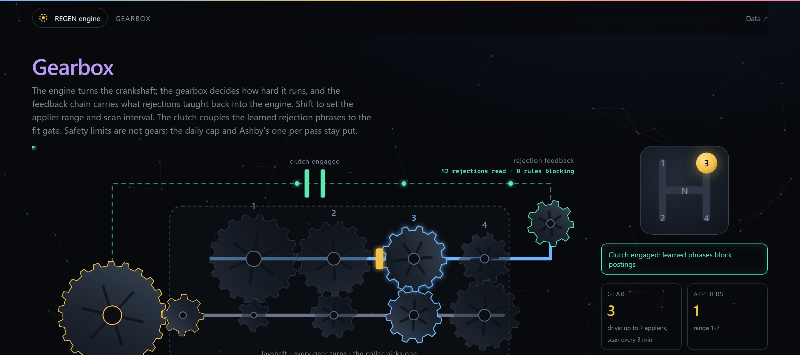
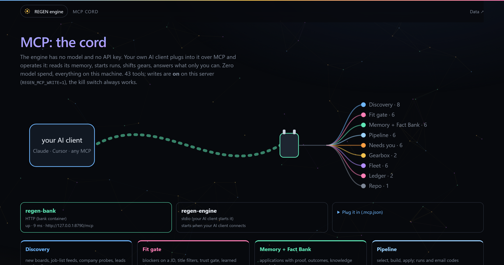

<div align="center">

# REGEN

**Be the first application they read, not the 400th.**

An open-source job engine that finds roles at the source, writes a resume that only claims what you can prove,
applies, and keeps a receipt for every submit. Your AI drives it. Zero model spend.

[](https://github.com/sameernagar-hub/regen-engine/actions/workflows/ci.yml)
[](LICENSE)
[](https://github.com/sameernagar-hub/regen-engine/wiki/Zero-Cost-and-MCP)
[](https://github.com/sameernagar-hub/regen-engine/wiki/MCP-Tools)

**[Live demo](https://regen-engine.onrender.com)** · [How it works](https://github.com/sameernagar-hub/regen-engine/wiki/How-it-works) · [Quick start](#quick-start) · [Wiki](https://github.com/sameernagar-hub/regen-engine/wiki) · [Technical reference](https://github.com/sameernagar-hub/regen-engine/wiki/Technical-Reference)

<a href="https://regen-engine.onrender.com"></a>

</div>

## The problem

A role goes live on a company's careers page. It reaches LinkedIn a day later, behind hundreds of identical resumes.
Auto-apply tools make it worse: one resume for every posting, invented answers for every gap.

## What REGEN does

- **Gets there first.** Polls ~6,400 employer boards on 9 ATSs, six big-tech careers portals and the venture-fund job portals (YC, Getro and Consider fund boards) directly, rescanning every few minutes, so roles are caught the hour they go live. Startups with no public board are traced through their own careers pages. [Discovery →](https://github.com/sameernagar-hub/regen-engine/wiki/Discovery)
- **Never bluffs.** Every resume line comes from your Fact Bank; a validator rejects anything else. Each application also carries a short cover note built from the same facts. [Tailoring →](https://github.com/sameernagar-hub/regen-engine/wiki/Tailoring)
- **Fills the page for each posting.** Each fact has several one-line wordings, each leading with a different angle (performance, reliability, AI, front end, data, hardware). The engine picks the wording that best matches the posting, fills one dense page from a ranked reserve of real bullets, and lists every remaining JD keyword on its own line. Each resume is self-tested before it is sent (one page, no wrapped bullets, page filled, keyword coverage), and wordings that led to interviews rank higher next time.
- **Skips what you'd lose.** A fit gate reads the whole job description first: sponsorship, years, clearance, stack. [Fit gate →](https://github.com/sameernagar-hub/regen-engine/wiki/Fit-Gate)
- **Learns from no.** Every rejection is read back and compared with the job descriptions that weren't rejected. [Feedback →](https://github.com/sameernagar-hub/regen-engine/wiki/Rejection-Feedback)
- **Never stalls.** When a form stops on a question, the engine calls you twice. If neither call is picked up, **Shadow**, your AI delegate, picks up and finishes the application as you, truthfully, from your presets and Fact Bank. The supervisor records who cleared every form: you, Shadow, or the engine's own rules. [Shadow ↓](#shadow)
- **Proves it.** A submit counts only when the confirmation page is saved. [Evidence →](https://github.com/sameernagar-hub/regen-engine/wiki/Evidence)
- **Costs nothing to think.** No model keys: Claude, Cursor or any MCP client operates it. [Zero cost →](https://github.com/sameernagar-hub/regen-engine/wiki/Zero-Cost-and-MCP)

## By the numbers

| 387 | 49 | ~6,400 | 43 | 0 |
|:-:|:-:|:-:|:-:|:-:|
| applications submitted | best day | employer boards watched | MCP tools | model API keys |

From the engine's own ledger as of 2026-10-30 (latest status per posting; `python -m engine report` lists the ones whose confirmation screenshot is still on disk). 286 tests in CI, plus a privacy gate on every push. [Metrics →](https://github.com/sameernagar-hub/regen-engine/wiki/Metrics)

## How it works

```
 discover ──► fit gate ──► compose ──► apply ──► inbox
    ▲            ▲                       ▲         │
    │            └──── rejection feedback ◄────────┘
    │                                    │
  sources ◄──────── MCP: your AI client ─┴──► gearbox (speed)
```

| | |
|:-:|:-:|
|  |  |
| **[Gearbox](https://github.com/sameernagar-hub/regen-engine/wiki/Gearbox).** One shift sets appliers and scan rate; the clutch couples what rejections taught. | **[The cord](https://github.com/sameernagar-hub/regen-engine/wiki/MCP-Tools).** 43 MCP tools reach every level, from finding new job sources to the kill switch. |

**[Maintenance](https://github.com/sameernagar-hub/regen-engine/wiki/Maintenance)** (the engine's "oil change"). Every application leaves
leftovers: tailored resumes, job-description copies, verification-code and job-alert mail, closed postings, Docker cache.
The supervisor measures them every 5 minutes as a health score and clears them once a day (or on a click at `/oilchange`),
playing each step live and logging what each one removed. Proof is shrunk, never deleted; your Fact Bank, answers, application log and starred mail are never touched.

### Shadow

```
 parked on a question ──► call 1 ──(timer)──► call 2 ──(timer)──► Shadow picks up ──► retried, answered as you
                             └────── you pick up (answer it, or press Pick up) ──────► the job waits for you
```

Shadow is your AI delegate (for its author, Claude, through the MCP cord). The gates treat Shadow and you as the same
person: an answer Shadow gives carries the weight of one you typed, and every one is logged with its source. For a
question your Fact Bank cannot settle, Shadow shows what it recommends while the calls ring; if nobody picks up, it
uses that answer and remembers it, so the same question is never drafted twice. Its memory learns from the rest of
the engine: your answers replace its own, and each remembered answer carries its record (submitted, parked again,
moved forward, corrected by you). The
backend is one small timer (`engine/shadow.py`, a 30-second tick in the answers container, no network calls); `/shadow`
in the control room shows the ignition sequence, every line ringing with its countdown, and who cleared the forms in
the last 24 hours. Modes: **two calls, then Shadow** (default), **Shadow always** (nothing parks), **only me**.
Shadow never invents experience or a fact (if the honest answer is no, it says no), never ticks a CAPTCHA, and
declines every EEO question. Concept credit: the watching-to-autopilot handoff of
[Oto.ai](https://github.com/KrishnaJ-bit/Memory_Meets_Motion) (Memory Meets Motion, 2026).

Everything runs in Docker on your machine: a pipeline, N appliers (headed Chromium), a supervisor that scales them,
a feedback loop on your inbox, a Postgres ledger, the control room, and the MCP server.
[Architecture →](https://github.com/sameernagar-hub/regen-engine/wiki/Architecture)

## Quick start

```bash
git clone https://github.com/sameernagar-hub/regen-engine && cd regen-engine
cp -r profile.example profile        # your facts and answers, once (git-ignored)
docker compose -f deploy/bank.compose.yml run --rm seed
REGEN_MCP_WRITE=1 docker compose -f deploy/bank.compose.yml up -d
```

Open the control room at http://127.0.0.1:3000 and plug your AI client into `http://127.0.0.1:8790/mcp`.
Step by step: [Running the engine](https://github.com/sameernagar-hub/regen-engine/wiki/Running) · [Configuration](https://github.com/sameernagar-hub/regen-engine/wiki/Configuration) · [Technical reference](https://github.com/sameernagar-hub/regen-engine/wiki/Technical-Reference).

## Guardrails

Legal and sponsorship answers come from your presets, from you, or from Shadow acting for you (kept on that one job);
EEO questions are always declined. CAPTCHAs and human checks always go to you; Shadow never touches them.
Personal data is only typed into employer-owned ATS forms that pass a scam check. Your data stays on your machine;
the only things published are an anonymized activity feed and the code, and a privacy gate blocks names and secrets from both. [Truthfulness and safety →](https://github.com/sameernagar-hub/regen-engine/wiki/Truthfulness-and-Safety)

## Learn more

[Wiki](https://github.com/sameernagar-hub/regen-engine/wiki) · [How it works](https://github.com/sameernagar-hub/regen-engine/wiki/How-it-works) · [Architecture](https://github.com/sameernagar-hub/regen-engine/wiki/Architecture) · [MCP tools](https://github.com/sameernagar-hub/regen-engine/wiki/MCP-Tools) ·
[Roadmap](https://github.com/sameernagar-hub/regen-engine/wiki/Roadmap) · [FAQ](https://github.com/sameernagar-hub/regen-engine/wiki/FAQ) · [Changelog](CHANGELOG.md) · MIT licensed
