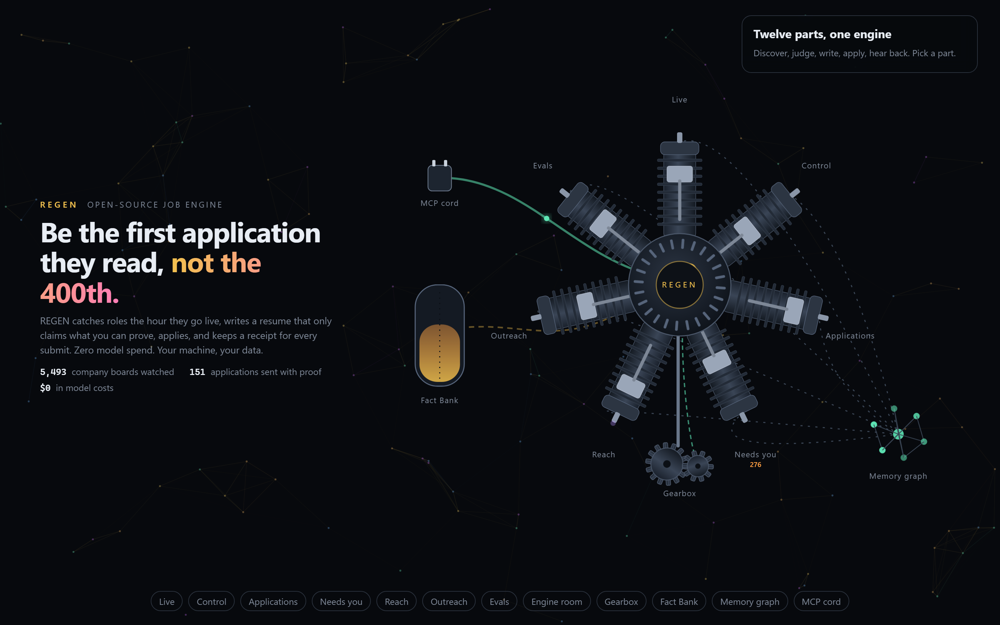

<div align="center">

# REGEN

**Be the first application they read, not the 400th.**

An open-source job engine that finds roles at the source, writes a resume that only claims what you can prove,
applies, and keeps a receipt for every submit. Your AI drives it. Zero model spend.

[](https://github.com/sameernagar-hub/regen-engine/actions/workflows/ci.yml)
[](LICENSE)
[](https://github.com/sameernagar-hub/regen-engine/wiki/Zero-Cost-and-MCP)
[](https://github.com/sameernagar-hub/regen-engine/wiki/MCP-Tools)

**[Live demo](https://regen-engine.onrender.com)** · **[Wiki](https://github.com/sameernagar-hub/regen-engine/wiki)** · [How it works](https://github.com/sameernagar-hub/regen-engine/wiki/How-it-works) · [Quick start](#quick-start)

<a href="https://regen-engine.onrender.com"></a>

</div>

> [!TIP]
> **Try it in a minute, nothing to set up:** `git clone` this repo, then `python -m engine try resume.txt` (a PDF
> needs `pip install pypdf`). It scans a sample of public boards and shows the 10 best-fitting fresh roles with the
> reason each passed. No database, no Docker, nothing applied, nothing saved.

> [!NOTE]
> **v2.0 "ALIVE" is being built.** The control room becomes the running engine, drawn as an electric drivetrain:
> every part is a real container, every pulse a real event, Shadow takes the wheel on screen, and 15 pages become 4
> rooms. It runs beside the current control room (`web-alive` on :3001) until it replaces it, one benchmarked phase
> at a time. **[Read the plan →](https://github.com/sameernagar-hub/regen-engine/wiki/Revamp-v2)**

## What it does

| | |
|---|---|
| **Gets there first** | Polls ~7,100 employer boards directly, minutes after a role goes live. [Discovery →](https://github.com/sameernagar-hub/regen-engine/wiki/Discovery) |
| **Never bluffs** | Every resume line comes from your Fact Bank; a validator rejects anything else. (One optional line of the posting's own keywords is off unless you switch it on for a run.) [Tailoring →](https://github.com/sameernagar-hub/regen-engine/wiki/Tailoring) |
| **Skips what you'd lose** | Reads the whole job description first: sponsorship, years, clearance, stack. [Fit gate →](https://github.com/sameernagar-hub/regen-engine/wiki/Fit-Gate) |
| **Never stalls** | Stuck on a question? Shadow, your AI delegate, answers as you, truthfully, or leaves it for you. [Shadow →](https://github.com/sameernagar-hub/regen-engine/wiki/Shadow) |
| **Proves it** | A submit counts only when the confirmation page is saved (its URL and text); the employer's "application received" email is the second check. [Evidence →](https://github.com/sameernagar-hub/regen-engine/wiki/Evidence) |
| **Learns from no** | Every rejection is read back and turned into the fit gate's next rule. [Feedback →](https://github.com/sameernagar-hub/regen-engine/wiki/Rejection-Feedback) |
| **Stays in control** | The supervisor's governor resizes the applier fleet every 15 s from memory, CPU, page timeouts and the daily cap, one applier at a time, so a run never outgrows the machine. [Gearbox →](https://github.com/sameernagar-hub/regen-engine/wiki/Gearbox) |
| **Costs nothing to think** | No model keys: Claude, Cursor or any MCP client operates it. [Zero cost →](https://github.com/sameernagar-hub/regen-engine/wiki/Zero-Cost-and-MCP) |

| 509 | 0.4 per 100 | ~7,100 | 43 | 0 |
|:-:|:-:|:-:|:-:|:-:|
| applications sent with proof | reached an OA or interview: 0.4 per 100 (1 OA, 1 interview; 95% interval 0.1 to 1.4) | employer boards watched | MCP tools | model API keys |

From the engine's own ledger as of 2026-11-13, outcomes checked by hand. The second number is the one that matters,
and it is low. `python -m engine report` and `python -m engine report rate` reproduce them; on 11-13 `report rate`
still printed 0.8 because the mail classifier had filed two "thank you for applying" mails as interviews and a job
alert as an offer (a known classifier bug, listed in the changelog). [Metrics →](https://github.com/sameernagar-hub/regen-engine/wiki/Metrics)

## Quick start

```bash
git clone https://github.com/sameernagar-hub/regen-engine && cd regen-engine
cp -r profile.example profile        # your facts and answers, once (git-ignored)
docker compose -f deploy/bank.compose.yml run --rm seed
REGEN_MCP_WRITE=1 docker compose -f deploy/bank.compose.yml up -d
```

Control room: http://127.0.0.1:3000 · MCP: `http://127.0.0.1:8790/mcp` · Step by step: [Running the engine](https://github.com/sameernagar-hub/regen-engine/wiki/Running)

## Guardrails

Never invents a fact, always declines EEO questions, never touches a CAPTCHA, and keeps your data on your machine.
[Truthfulness and safety →](https://github.com/sameernagar-hub/regen-engine/wiki/Truthfulness-and-Safety)

---

**Everything else lives in the [wiki](https://github.com/sameernagar-hub/regen-engine/wiki)**:
[Architecture](https://github.com/sameernagar-hub/regen-engine/wiki/Architecture) · [MCP tools](https://github.com/sameernagar-hub/regen-engine/wiki/MCP-Tools) · [Technical reference](https://github.com/sameernagar-hub/regen-engine/wiki/Technical-Reference) · [Roadmap](https://github.com/sameernagar-hub/regen-engine/wiki/Roadmap) · [FAQ](https://github.com/sameernagar-hub/regen-engine/wiki/FAQ) · [Changelog](CHANGELOG.md) · MIT licensed
