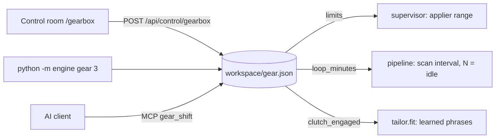

# Gearbox

**Thesis:** one control should set how hard the engine runs. Before v1.1 that took four environment variables and a
container recreate; now it is one shift, applied within a minute, from the control room, the CLI or any AI client.


## What a gear sets

| Gear | Appliers (min-max) | Scan every | Use it when |
|---|---|---|---|
| **N** | 0-0 | no new passes | you want the engine idle without a kill (in-flight forms finish) |
| **1** crawl | 1-1 | 10 min | watching a new ATS or a rule change closely |
| **2** cruise | 1-3 | 5 min | a laptop on battery, or a quiet day |
| **3** drive | 1-7 | 3 min | the default: the same as the 10-18 start command |
| **4** overdrive | 2-9 | 2 min | a big fresh supply (new feed, morning postings) |

**Not gears** (safety limits stay where they are in every gear): the daily cap `REGEN_MAX_PER_DAY`, Ashby one
submit per pass (its bot detection flags faster rates), the supervisor's `HARD_MAX` of 12 appliers, the 3-per-company
daily cap and every airbag.

## The clutch

The clutch couples the [rejection feedback](Rejection-Feedback) to the fit gate:

- **engaged** (default): active learned phrases block new postings (`learned: <phrase>` in the skip reason).
- **out**: the feedback loop keeps learning and reporting, but only the base fit gate decides.

## How it is wired



`workspace/gear.json` is the single source. The supervisor reads the applier range through `limits()` (a gear wins
over `fleet_limits.json` and the env defaults); the pipeline re-reads the interval every minute while it sleeps, so a
shift takes effect without a restart; `tailor.fit()` checks the clutch before adding learned blockers. Every shift is
an audited `gear` event (who, which gear, clutch).

## The animation

The page is a real constant-mesh gearbox. The crankshaft (engine) drives the layshaft; every layshaft gear turns
every main-shaft gear all the time, and the selector collar slides to lock one of them to the output shaft. Each
gear's angle is derived from the crankshaft angle with the tooth ratio and a mesh phase
(`θ2 = −(n1/n2)·θ1 + (1 + n1/n2)·φ + 180°/n2`), so teeth never pass through each other, and the crankshaft speed eases
toward the gear's target speed (spool up / down). Reduced-motion users get a still picture.

## Use it

```bash
python -m engine gear              # show gear, clutch and what they set
python -m engine gear 4            # shift
python -m engine gear --clutch off # decouple the learned phrases
```

In Docker: `docker exec -u 10001 deploy-pipeline-1 python -m engine gear 3`. Over MCP: `gearbox_status`, `gear_shift`.

## Evidence

- `engine/gearbox.py`, `apps/api/control.py` (`/api/control/gearbox`), `apps/web/app/gearbox/page.tsx`
- `tests/test_feedback.py::test_gearbox_sets_appliers_loop_and_clutch`: gears drive `limits()`, the loop interval and
  the clutch.

Related: [Rejection feedback](Rejection-Feedback) · [Scale-out](Scale-Out) · [Control room](Control-Room) · [MCP tools](MCP-Tools)
