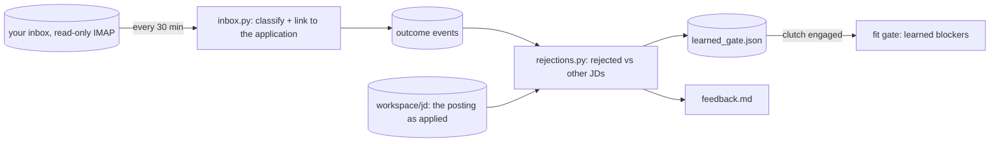

# Rejection feedback

**Thesis:** every "no" carries information. The `feedback` container reads each rejection, compares the job
description that got rejected with the ones that didn't, and teaches the fit gate, but only when the evidence would
survive a statistician.

## The loop

## How a phrase earns a rule

1. **Requirement sentences only.** Sentences with a requirement cue (experience, required, must, degree, years,
   proficient, familiar...) become 2-3 word phrases. Benefits, EEO and "about us" text never count.
2. **Candidate** when the phrase appears in **4+ rejected** JDs, its rejection rate is **1.5x the baseline**, it
   never appeared where an **OA, interview or offer** came back, and the **Fact Bank doesn't already cover it**
   (the gate learns what you lack, not what the market dislikes).
3. **Active** (blocks) only when it is significant after a **Bonferroni correction**: the binomial tail
   `P(X ≥ rejected | seen, baseline)` times the number of phrases tested must be below **0.05**. Everything else is
   **proposed**: reported and watched, never blocking.
4. **Off** when you say so (`python -m engine feedback --off "<phrase>"`, the control room table, or MCP
   `feedback_rule_off`); later passes keep it off.

## Why the correction matters (first run, 2026-10-19)

The first pass read 48 new outcomes and analyzed 42 rejected of 150 submitted JDs (baseline rejection rate 0.28).
Raw lift promoted 15 phrases, and every one was boilerplate: "problem solving", "apply even if", "based on factors",
"rather than". With ~800 phrases tested, 6 rejections out of 10 sightings is what chance produces. After the
correction: **0 active, 16 proposed**. A rule blocks only when the data really says so.

## Outputs

| File | What it holds |
|---|---|
| `workspace/feedback.md` | rejected / baseline, every candidate with its evidence, and "would today's gate have caught them?" (the current fit gate re-run on every rejected JD) |
| `workspace/learned_gate.json` | rules with `rejected`, `seen`, `rate`, `lift`, `p_adj`, `status` (active / proposed / off) |
| `feedback` events | one per pass: new outcomes, rejected JDs, active rules |

The [gearbox](Gearbox) page shows the same table, and its clutch decides whether active rules block.

## Running it

The `feedback` service in `deploy/bank.compose.yml` runs `python -m engine feedback --watch 30` with the same
read-only Gmail app password as the supervisor's IMAP codes. By hand: `python -m engine feedback` (one pass) or
`--no-imap` (analyze what the ledger already has). Cost per pass: O(J · W) for J job descriptions of W words.

## Evidence

- `engine/feedback/rejections.py`, `tests/test_feedback.py` (requirement sentences only, Fact-Bank exclusion, positive
  outcomes veto a phrase, too few rejections learn nothing, boilerplate stays proposed, user "off" survives a pass).

Related: [Outcomes and learning](Outcomes-and-Learning) · [Fit gate](Fit-Gate) · [Gearbox](Gearbox) · [Metrics](Metrics)
