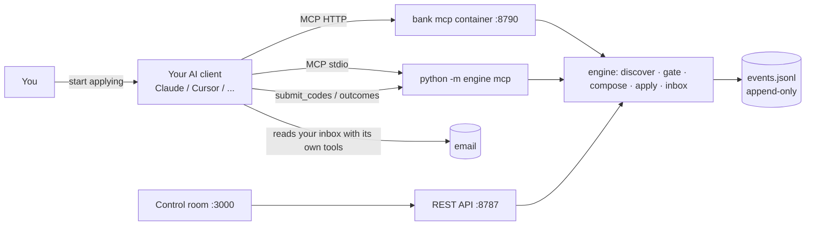

# Zero cost: your AI runs the engine

REGEN has **no paid API keys and no hosted model**. The intelligence comes from the AI client you already use
(Claude Desktop / Claude Code, Cursor, any MCP-capable assistant), connected to the engine over the
[Model Context Protocol](https://modelcontextprotocol.io). The engine is the hands; your assistant is the head.

## Why this design
| Concern | Hosted-LLM design | REGEN |
|---|---|---|
| Cost | per-token bills, API keys to manage | $0: uses the assistant you already pay for or run locally |
| Secrets | keys in `.env`, rotation, leaks | no model keys exist to leak |
| Privacy | resume + answers sent to a third-party API | data stays on disk; the assistant sees only what a tool returns |
| Truth | model can invent experience | writing is template + Fact Bank only (see [Tailoring](Tailoring)); the assistant orchestrates, it doesn't author claims |

## What the assistant can call

**43 tools at every level of the engine**: discovery (add boards, job-list feeds, company probes, leads), fit gate,
pipeline, answers, gearbox, memory, fleet (scale, kill switch), ledger and repo. The full, generated catalog is
[MCP tools](MCP-Tools). Read tools are always on; write tools need `REGEN_MCP_WRITE=1` on the server.

| Server | Transport | Where | Data |
|---|---|---|---|
| `regen-bank` | HTTP, `http://127.0.0.1:8790/mcp` | the bank's `mcp` container (127.0.0.1 only, DNS-rebinding protection) | the live Docker volumes |
| `regen-engine` | stdio, `python -m engine mcp` | started by your AI client from the repo | your local `workspace/` |

Plug in with the repo's `.mcp.json` (Claude Code asks you to trust the folder first) or
`claude mcp add --transport http regen-bank http://127.0.0.1:8790/mcp`. The control room's `/mcp` page shows both
sockets live and every tool on the engine part it drives.

**An AI that finds jobs.** The discovery tools let the assistant look for new places jobs are posted (lists,
newsletters, company pages it reads with its own tools) and hand them to the discover stage: `feed_add` for a job
list, `boards_add` for ATS links, `companies_probe` for names, `leads_add` for single postings. Every add is an
audited `source` event; the fit gate, trust gate and caps still decide what is applied to. First use (10-19): one new
list, +71 boards.

The same operations exist in the CLI (`python -m engine ...`) and the control room, so nothing depends on any one
assistant.

## Evidence
- `engine/connectors/mcp_server.py`: the tool definitions ([MCP tools](MCP-Tools) is generated from it).
- `tests/test_feedback.py`: the catalog marks writes; discovery adds land in `boards.json` / `sources.json`.
- `tests/test_api.py`: API parity for the read surface.
- No model SDK appears in `requirements.txt`; `grep -ri "api_key" engine/` finds none.
